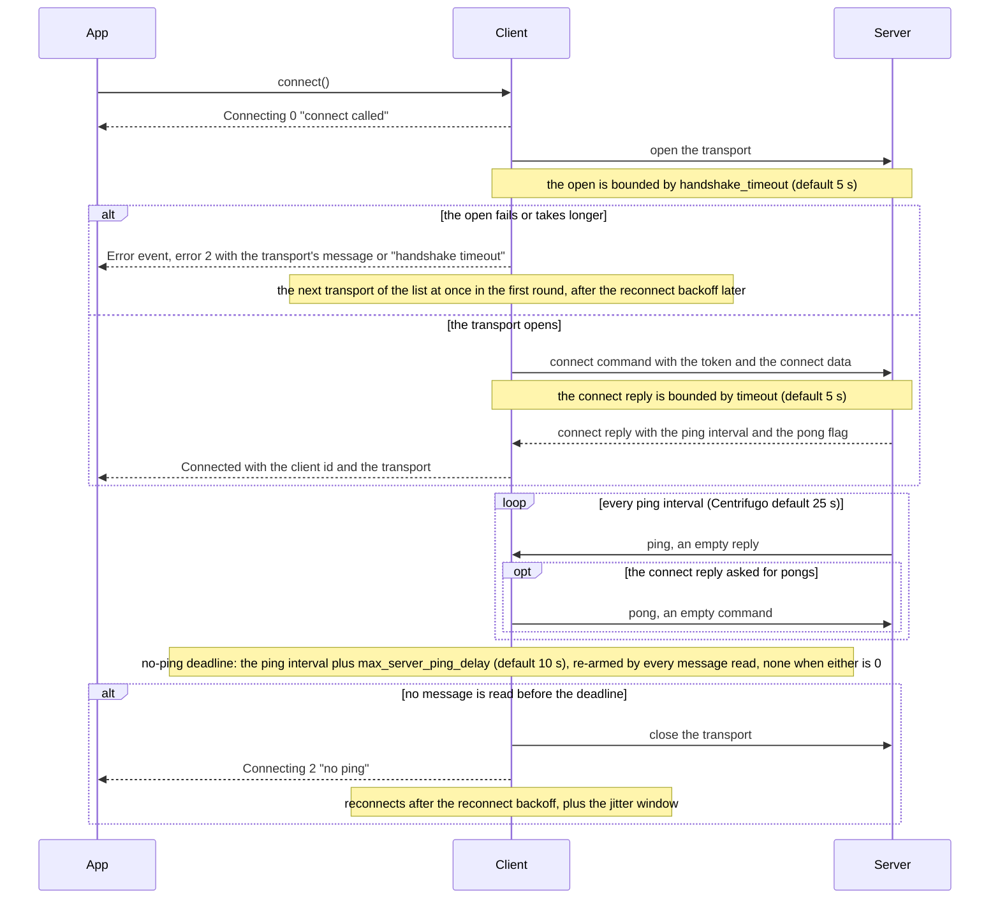
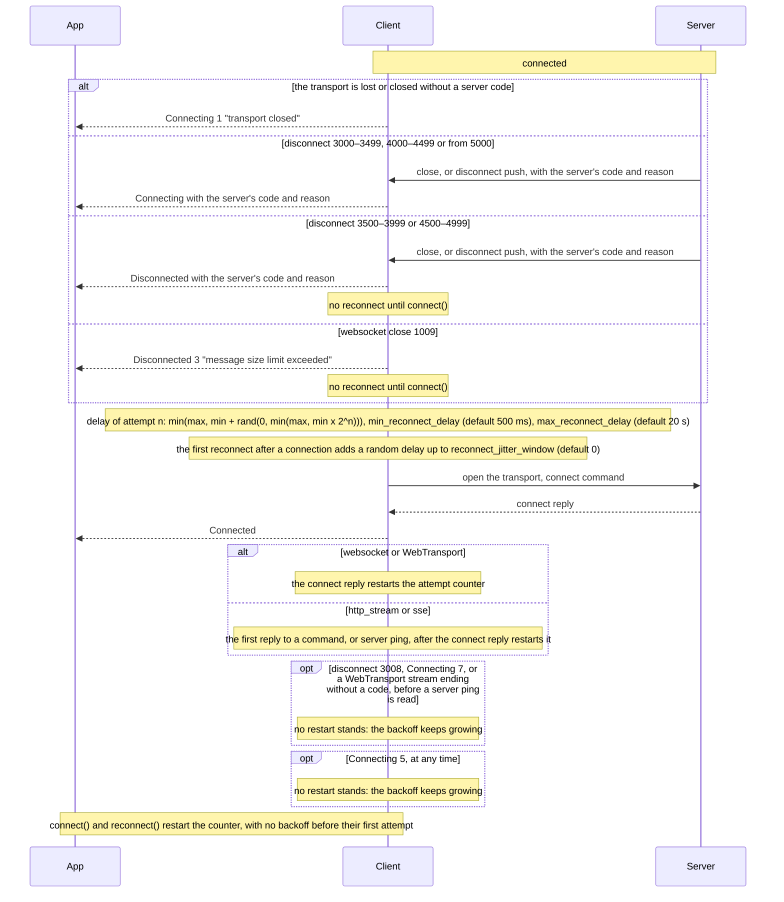
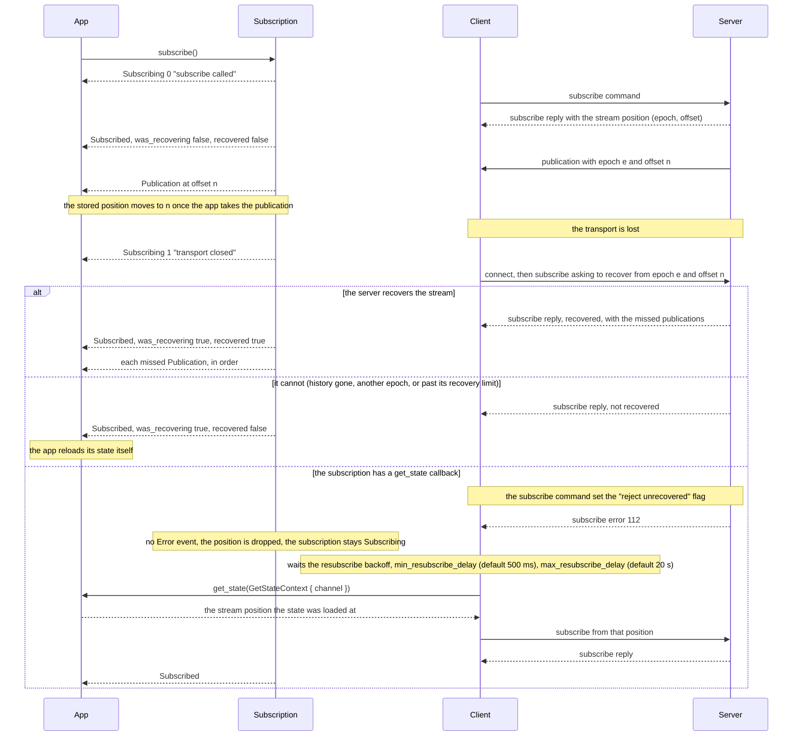
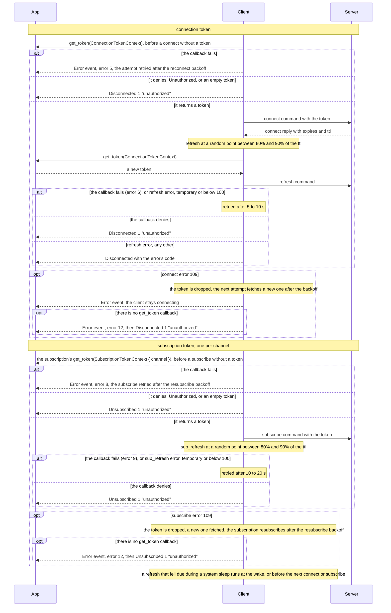
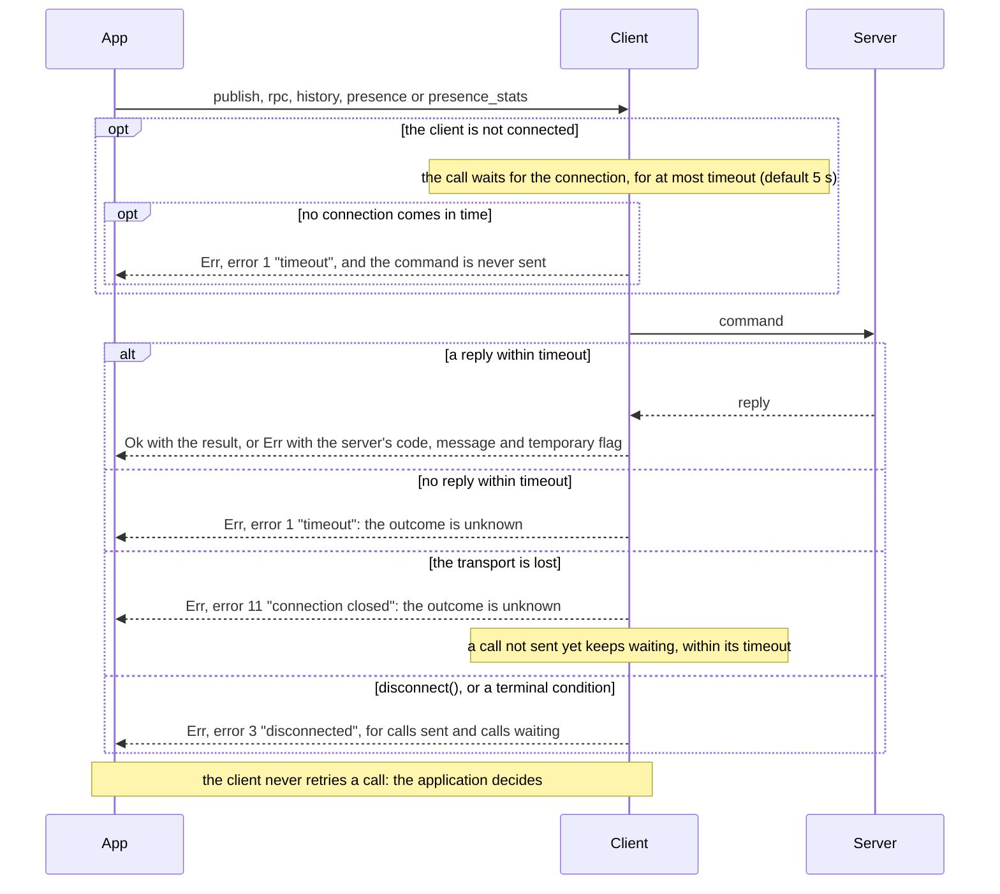
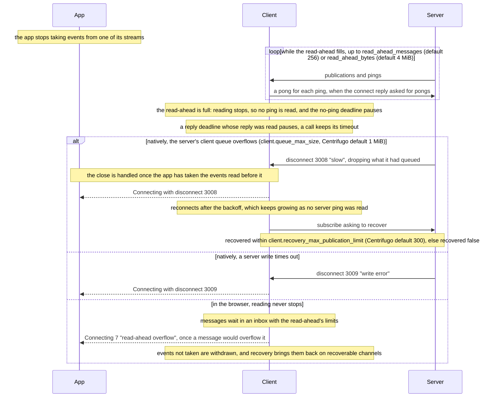

# Protocol flows

How the client talks to a Centrifugo server, drawn as sequence diagrams.
Each one shows the application's calls and events next to the messages on
the wire, the timers that bound each step, and the branches the client
takes when something fails. The [resilience guide](resilience.md) says what
the application should do about each failure, and the
[codes table](../README.md#codes) lists every code.

`Connecting`, `Connected` and `Disconnected` are `ClientEvent`s;
`Subscribing`, `Subscribed`, `Publication` and `Unsubscribed` are
`SubscriptionEvent`s; an `Error` event carries a `ClientError`. A
client-side code is written with its kind (`connecting` 2 "no ping"), a
server code after the kind of message that carries it (disconnect 3008).
Options are fields of `Config`, or of a subscription's options where a
diagram says so. Blocks are those of the repository's
[CLAUDE.md](../CLAUDE.md), which these diagrams follow.

Sources: Block 34 D1; Block 59 D2; Block 59 D4

## Connect and heartbeat

Sources: Block 1 "Successful connect"; Block 2; Block 4 "Client answers ping with pong", "Client does not answer when pong is not expected", "Missing pings trigger reconnect", "Regular pings keep the connection alive"; Block 8 "Every transport unreachable"; Block 14 "Reconnect jitter window"; Block 15 "In order, one message at a time"; Block 29 D1; `src/machine.rs::timer_fired`

## Disconnect and reconnect

Sources: Block 1 "Temporary connection loss then successful reconnect", "Connection loss then terminal error on reconnect"; Block 2 "Delay upper bound per attempt", "Delays are jittered"; Block 3 "Application disconnect codes sent via server API", "Protocol-range disconnect codes", "Close code 1009 stops the client"; Block 14 "Reconnect jitter window", "Without a jitter window the first reconnect follows the backoff"; Block 15 "Backoff after 3008", "Reconnect delays keep growing while the server closes each connection with 3008", "A server ping read before 3008 lets the reset stand"; Block 19 D8; Block 25 D5; Block 44 D7; Block 48 D9; `src/machine.rs::an_emulated_connect_reply_alone_does_not_reset_the_backoff`

## Subscription and recovery

Sources: Block 9 "Subscribe while connected", "Resubscribe after reconnect"; Block 10 "Resubscribe delays are bounded"; Block 11 "A first subscribe does not recover", "Missed publications are recovered", "Recovery fails when history is gone", "getState provides the position of the initial subscribe", "getState reloads state when recovery fails"; Block 15 "Delivered means taken"

The resubscribe backoff options are a subscription's (`SubscriptionBuilder`).
`get_state` is also called before the first subscribe of a subscription
without `since`.

## Token lifecycle

Sources: Block 1 "Terminal condition while connected"; Block 5 "Token refreshed before expiry keeps the connection"; Block 10 "Subscription token refreshed before expiry keeps the subscription", "A failing first subscription token fetch is retried before subscribing", "A failing subscription token callback is retried", "A temporary sub_refresh error is retried", "Subscription token denied", "Subscribe error 109 fetches a new token and resubscribes", "A subscribe rejected for an expired token without a callback unsubscribes"; Block 14 "Token refresh jitter"; Block 17; Block 25 D3 "A refresh due during a short sleep starts at the wake", "A token due during a long sleep is fetched before the next connect"; `src/machine.rs::failed_connect_fetch_is_reported_and_retried_with_backoff`; `src/machine.rs::failed_refresh_fetch_is_reported_and_retried_in_5_to_10_s`; `src/machine.rs::refresh_reply_errors_retry_when_temporary_and_disconnect_otherwise`; `src/machine.rs::connect_error`

## Calls and timeouts

Sources: Block 13 "A call made while connecting waits for the connection", "A queued call fails after the timeout when no connection comes", "A call that timed out while queued is never sent", "A call without a reply times out", "Temporary RPC error is reported as such", "Losing the transport fails calls already sent at once", "A call waiting for room keeps its deadline when the transport is lost", "Disconnect fails a call already sent at once", "A terminal connect failure fails a queued call at once"; Block 34 D1

## Backpressure

Sources: Block 4; Block 13 "call replies"; Block 15 "Bounded read-ahead", "Head-of-line", "Recovery larger than the server's queue", "A stream that is not read stops the client reading after 256 items", "Pings are answered while a stream is not read", "A full read-ahead does not make the client report missing pings", "The server closing the connection is handled only after the publications before it are taken", "A slow consumer on a channel with history and recovery loses no publication"; Block 44 D7
